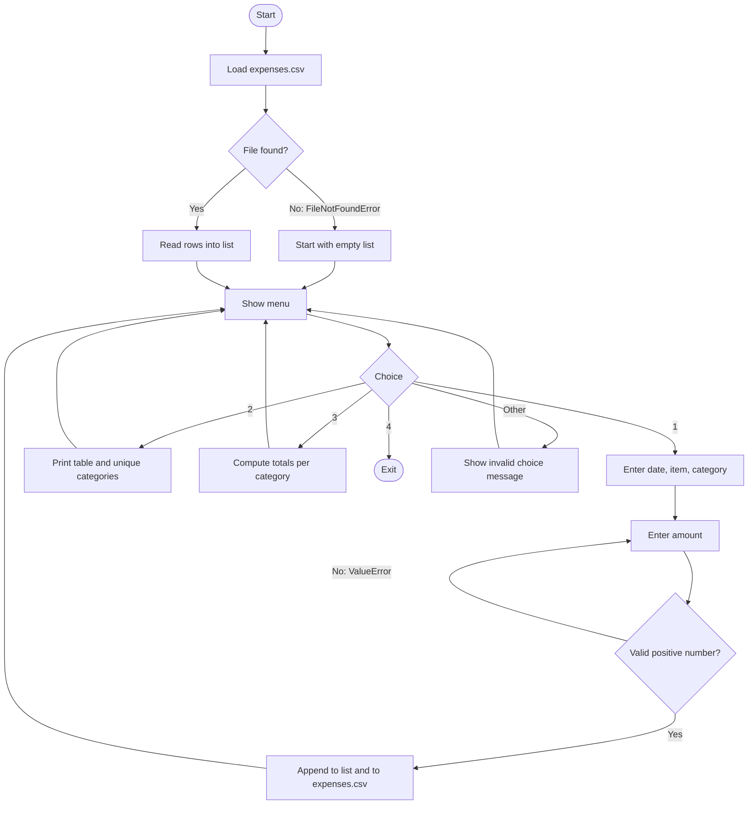
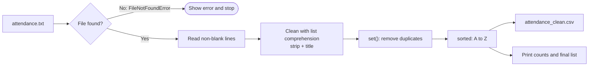

https://raw.githubusercontent.com/muhammadaliajaz/python-files-errors-assessment/main/banner.svg
# Python Files & Errors Assessment

Two small command-line tools for a training institute, built with Python's **file handling**, **exception handling**, **sets** and **comprehensions**. No external libraries are required.

| Program | Purpose | Input | Output |
|---|---|---|---|
| `expense_tracker.py` | Record and summarize daily operational expenses | User input, `expenses.csv` | `expenses.csv` |
| `attendance_cleaner.py` | Clean, de-duplicate and sort student attendance | `attendance.txt` | `attendance_clean.csv` |

## Live Demo

An interactive browser version of both tools is included in `demo.html`. It uses the same validation, CSV format and cleaning steps as the Python scripts, so you can try the project without installing anything.

| Option | Link |
|---|---|
| Instant preview (no setup) | [Open demo](https://htmlpreview.github.io/?https://github.com/muhammadaliajaz/python-files-errors-assessment/blob/main/demo.html) |
| GitHub Pages | [Open demo](https://muhammadaliajaz.github.io/python-files-errors-assessment/demo.html) |
| Locally | Download `demo.html` and double-click it |

> The Pages link works after you enable **Settings > Pages > Deploy from a branch > main / (root)**. If your default branch is `master`, change `main` to `master` in the instant preview link.

What the demo shows:

- **Expense Tracker:** add expenses, see invalid amounts rejected, view unique categories and totals, and watch `expenses.csv` update. **Simulate restart** shows that saved data is loaded again.
- **Attendance Cleaner:** edit the raw `attendance.txt` text, clean it, see the record counts, and download `attendance_clean.csv`.

## Repository Structure

```
python-files-errors-assessment/
├── expense_tracker.py
├── attendance_cleaner.py
├── attendance.txt
├── demo.html
└── README.md
```

`expenses.csv` and `attendance_clean.csv` are created automatically when the programs run.

## Requirements

Python 3.8 or later.

## How to Run

```bash
git clone https://github.com/muhammadaliajaz/python-files-errors-assessment.git
cd python-files-errors-assessment

python expense_tracker.py        # Task 1
python attendance_cleaner.py     # Task 2
```

Use `python3` instead of `python` on macOS/Linux if needed.

---

## Task 1: Expense Tracker

Menu-driven program that stores expenses in `expenses.csv` with the columns `date,item,category,amount`.

**Menu**

1. Add New Expense
2. Show All Expenses
3. Calculate Total Expenses by Category
4. Exit

**Working flow**



## Task 2: Attendance Cleaner

Reads `attendance.txt` (one name per line), cleans the names, removes duplicates, sorts them and saves `attendance_clean.csv`.

**Working flow**



---

## Errors Handled

| Error | Where | Why it is handled |
|---|---|---|
| `FileNotFoundError` | Expense tracker, on startup | First run has no `expenses.csv`. The program starts with an empty list instead of crashing; the file is created on the first save. |
| `ValueError` (amount) | Expense tracker, amount input | Text such as `abc`, or a zero/negative amount, is not a valid expense. The user is asked again until the input is valid. |
| `ValueError` (date) | Expense tracker, date input | Dates must follow `YYYY-MM-DD` so records stay consistent and sortable. |
| `ValueError` / `KeyError` (corrupt row) | Expense tracker, loading | A damaged CSV row is skipped with a warning, so one bad line does not block the whole program. |
| `FileNotFoundError` | Attendance cleaner | If `attendance.txt` is missing, a clear message is shown instead of a traceback. |

## How Sets and List Comprehensions Are Used

**Sets** store only unique values, which makes them ideal for removing duplicates.

```python
# expense_tracker.py: all unique categories
unique_categories = {e["category"] for e in expenses}

# attendance_cleaner.py: unique students
unique_students = set(cleaned)
```

**List comprehensions** build new lists in one readable line.

```python
# attendance_cleaner.py: clean every name
cleaned = [" ".join(name.strip().split()).title() for name in raw_names]
```

Category totals use a **dictionary comprehension** over the set of categories:

```python
totals = {c: sum(e["amount"] for e in expenses if e["category"] == c)
          for c in sorted(categories)}
```

Note: `title()` is also applied to categories, so `stationery` and `Stationery` are treated as the same category.

---

## Sample Runs

### Expense Tracker: data is saved and loaded again

**Run 1:** no `expenses.csv` exists. Invalid amounts (`abc`, `-5`) are rejected, then valid expenses are added.

```
expenses.csv not found. Starting with an empty expense list.
Loaded 0 saved expense(s).

Choose an option (1-4): 1
Date (YYYY-MM-DD): 2025-03-01
Item name: A4 Paper
Category: stationery
Amount: abc
Invalid amount. Please enter a positive number, e.g. 1250.50
Amount: -5
Invalid amount. Please enter a positive number, e.g. 1250.50
Amount: 1250.50
Expense saved.
... (3 more expenses added: Internet Bill, Tea & Snacks, Van Fuel)

Choose an option (1-4): 3

Category                   Total
--------------------------------
Refreshments              800.00
Stationery               1250.50
Transport                3000.00
Utilities                4500.00
--------------------------------
Grand Total              9550.50

Choose an option (1-4): 4
Goodbye!
```

**`expenses.csv` after Run 1**

```csv
date,item,category,amount
2025-03-01,A4 Paper,Stationery,1250.5
2025-03-02,Internet Bill,Utilities,4500.0
2025-03-03,Tea & Snacks,Refreshments,800.0
2025-03-04,Van Fuel,Transport,3000.0
```

**Run 2:** the program is restarted; the previous data is loaded automatically.

```
Loaded 4 saved expense(s).

Choose an option (1-4): 2

Date        Item                  Category            Amount
------------------------------------------------------------
2025-03-01  A4 Paper              Stationery         1250.50
2025-03-02  Internet Bill         Utilities          4500.00
2025-03-03  Tea & Snacks          Refreshments        800.00
2025-03-04  Van Fuel              Transport          3000.00

Unique categories: Refreshments, Stationery, Transport, Utilities
```

### Attendance Cleaner

Input `attendance.txt` contains 12 non-blank lines with mixed capitalization, extra spaces, and duplicates.

```
Original records : 12
Unique students  : 7
Saved to         : attendance_clean.csv

Cleaned attendance list:
  1. Ahmed Ali
  2. Ali Raza
  3. Bilal Ahmad
  4. Fatima Noor
  5. Hina Malik
  6. Sara Khan
  7. Umar Farooq
```

---

## Test Cases

### Expense Tracker

| # | Scenario | Input | Expected Result | Status |
|---|---|---|---|---|
| E1 | First run, no CSV file | Start program | Message shown, empty list, no crash | Pass |
| E2 | Show expenses when empty | Option 2 | "No expenses recorded yet." | Pass |
| E3 | Add valid expense | `2025-03-01`, `A4 Paper`, `stationery`, `1250.50` | Saved; category stored as `Stationery` | Pass |
| E4 | Non-numeric amount | `abc` | Error message, amount asked again | Pass |
| E5 | Negative amount | `-5` | Error message, amount asked again | Pass |
| E6 | Invalid date format | `15-03-2025` | Error message, date asked again | Pass |
| E7 | Data persists | Add expenses, exit, restart | All expenses loaded and displayed | Pass |
| E8 | Unique categories | Option 2 with 4 categories | Each category listed once, sorted | Pass |
| E9 | Totals by category | Option 3 | Correct per-category and grand total (9550.50) | Pass |
| E10 | Invalid menu choice | `9` | "Invalid choice" message, menu shown again | Pass |

### Attendance Cleaner

| # | Scenario | Input | Expected Result | Status |
|---|---|---|---|---|
| A1 | Extra spaces | `  ali raza` | `Ali Raza` | Pass |
| A2 | Inconsistent capitalization | `SARA KHAN`, `sara khan` | `Sara Khan` | Pass |
| A3 | Duplicates removed | 12 records | 7 unique students | Pass |
| A4 | Blank lines | Empty line in file | Ignored, not counted | Pass |
| A5 | Alphabetical order | Unsorted names | Sorted A to Z in output | Pass |
| A6 | CSV output | Run program | `attendance_clean.csv` created with header `student_name` | Pass |
| A7 | Missing input file | Delete `attendance.txt` | Clear error message, no traceback | Pass |

## Author

Muhammad Ali Ajaz
